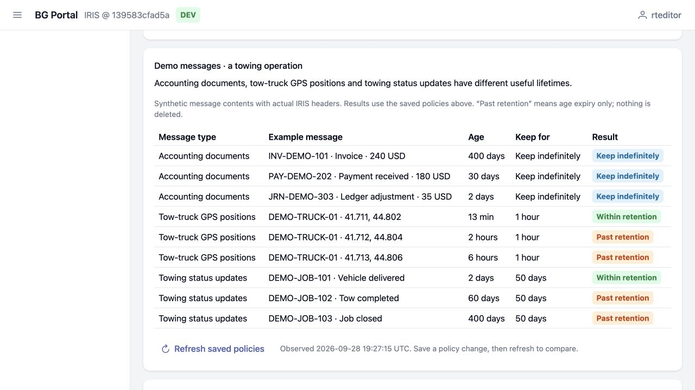

# Production Message Retention for BG Portal

An independent extension for [Sergei's BG Portal](https://github.com/banksiaglobal/bg-portal).
Choose retention periods by production message body class and preview the affected
headers inside Portal's own navigation, page layout and dashboard.

A practical companion to Portal's extension model: its own repository, ZPM package,
domain service and data, with **no changes to Portal core or frontend**.

**Version 0.2.0 plans retention; it does not delete messages or schedule cleanup.**
“Never expire” records an intention and does not override existing IRIS purge jobs.
The [engineering assessment](DESIGN.md) explains the integrity constraints and why
deletion needs a separate design.



## Add it to an existing Portal

Requirements:

- IRIS with interoperability available in the Portal namespace.
- `bg-portal-core` 0.1.x, extension API 2. Tested on
  [Portal commit 1842205](https://github.com/banksiaglobal/bg-portal/commit/1842205d2c200ab1d64b94b44dc4b7ef2394b2e4).
  Use that commit or a newer build with the same page/broker resource checks;
  the core's `0.1.0` version alone does not distinguish earlier builds.
- ZPM/IPM enabled in that namespace. The Docker helper is tested with IPM 0.10.9.
- An administrator to install the package and grant access.

For a running Portal Docker container:

```sh
git clone https://github.com/bg-ak/bg-portal-ext-message-retention.git
cd bg-portal-ext-message-retention
sh scripts/install.sh YOUR_PORTAL_CONTAINER
```

Replace `YOUR_PORTAL_CONTAINER` with its name from `docker ps`. The default
namespace is `USER`; pass another namespace as the second argument if needed.
The helper copies only the manifest and extension source, calls IPM and verifies
its returned status.
It does not change Portal source, authentication, roles or existing purge settings.

For an installation without Docker, copy this checkout to the IRIS server and run
in the namespace hosting Portal:

```objectscript
zpm "load /absolute/path/to/bg-portal-ext-message-retention"
```

This repository is the installation source. The package has **not** been published
to a ZPM registry, so use `load`, not `install bg-portal-ext-message-retention`.
No npm build is needed.

Sign in to Portal and open **Interoperability → Message retention**, or append
`/csp/portal/BG.Retention.Portal.Page.cls` to your Portal origin. A dashboard widget
also links to it, and **Extensions** identifies the separate module.

Installation creates `BG_RetentionView` and `BG_RetentionEdit` with no public grants.
An administrator can try the disposable demo immediately. For ordinary users,
apply the [role and SQL permissions](docs/OPERATIONS.md#access) to the intended role.

## Try the demonstration in a minute

Use an **isolated demo instance with no existing message headers or retention
policies**. Demo data is optional and is not installed by the ZPM module.

```sh
sh demo/seed.sh YOUR_PORTAL_CONTAINER --disposable
```

For a non-default namespace, append its name after `--disposable`.
The seed creates **nine actual synthetic messages** and three named policies:

| Message type | Retention | Example |
| --- | --- | --- |
| Accounting documents | Keep indefinitely | A 400-day-old invoice remains in the keep category |
| Tow-truck GPS positions | 1 hour | A recent position stays; 2-hour and 6-hour positions are past retention |
| Towing status updates | 50 days | A 2-day-old update stays; 60-day and 400-day updates are past retention |

1. Open **Message retention**. Read the policy names and **Why keep it this long?**
2. Below them, **Demo messages · a towing operation** shows each message's content,
   age, saved retention rule and result. The examples include invoices, payments,
   vehicle coordinates and towing-job updates, not just technical header IDs.
3. Open **Edit / preview** for **Tow-truck GPS positions**. Change **Hours** from
   **1** to **3**, then preview: only the 6-hour position matches instead of two.
4. Save the change, then click **Refresh saved policies** in the demo table. The
   2-hour position changes from **Past retention** to **Within retention**.
5. Return GPS to **1 hour** if you want to restore the initial demonstration.
   Accounting documents still have no age expiry regardless of their age.

Counts above apply soon after seeding. Ages advance with real time. “Past retention”
is an age result, not authorization to delete. The normal preview still checks
session and shared-body cautions. An hour is 60 minutes; a day is 24 hours, in UTC.

The optional demo component reads only its tracked synthetic message bodies. The
main extension's production analysis remains header-only. The seed refuses occupied
namespaces and repeated runs, and commits its messages and policies together.
For server-side commands, demo resets and lifecycle checks, see
[the demo guide](demo/README.md).

## Verify

Run before seeding the visual demo, on a disposable instance with the extension
installed and an empty header/policy store:

```sh
sh tests/run.sh YOUR_DISPOSABLE_CONTAINER --disposable
```

Expected: `RETENTION TESTS PASSED: 34`, `RETENTION HOUR TESTS PASSED: 13`,
and `RETENTION DEMO TESTS PASSED: 15` (62 checks). All three suites roll back their fixture data. The wrapper requires explicit success
markers as well as a successful process exit. See the
[verification record](VERIFICATION.md) and [limited-user probes](tests/SECURITY.md).

## How it fits together

- `src/cls/BG/Retention/`: policies, audit history and IRIS header analysis.
- `src/cls/BG/Retention/Portal/`: native page, navigation, widget and lifecycle guard.
- `module.xml`: independently installable package; depends on `bg-portal-core`.
- `demo/`: optional synthetic bodies, seed and a Portal widget contribution, outside the installed package.
- `tests/`: executable domain, lifecycle and demo checks.

The domain service does not depend on Portal or Bloom. Read the
[operations guide](docs/OPERATIONS.md) for headless calls, authorization, bounded
queries and uninstall/reinstall, and [DESIGN.md](DESIGN.md) for the architecture
assessment and possible general improvements to the extension API.

## License

Copyright (C) 2026 Alexander Kolesov. [GNU AGPL version 3](LICENSE).
BG Portal is a separate project by its respective authors, with its own license.
