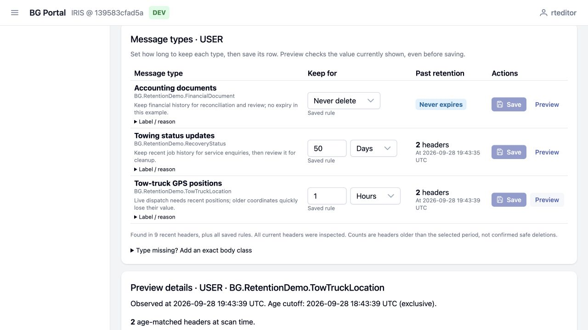

# Demo: different messages, different lifetimes

Install the extension using the root [README](../README.md). Use a disposable IRIS
instance with no existing message headers or retention policies. No real vehicle,
customer or financial information is used in this demonstration.

```sh
sh demo/seed.sh YOUR_PORTAL_CONTAINER --disposable
```

The optional final argument selects the namespace hosting Portal. The command
loads the optional demo classes and contribution, then creates nine synthetic
bodies, their real IRIS headers, and three policies. Reload the retention page.
Ordinary ZPM installation does not import demo or test classes.

## What the visitor sees

| Type | Message ages at seeding | Saved rule | Initial result |
| --- | --- | --- | --- |
| Accounting documents | 400, 30 and 2 days | Keep indefinitely | Keep all three, including the oldest invoice |
| Tow-truck GPS positions | 10 minutes, 2 hours, 6 hours | 1 hour | Keep the recent position; two are past retention |
| Towing status updates | 2, 60 and 400 days | 50 days | Keep the recent job update; two are past retention |

The first screen is a **Message types** table. Each row has the exact body class,
its business label/reason, an editable **Keep for** value, and **Save / Preview**
actions. Accounting is set to **Never delete**, GPS to **1 Hours**, and towing
updates to **50 Days**.

Change the GPS amount to **3** directly in its row and click **Preview**: only the
6-hour position matches. **Save** persists that type's rule. **Undo** restores its
saved value; saving or undoing one row leaves other drafts alone.

The individual messages are behind **Example messages (optional demonstration)**.
Expand it and click **Refresh saved policies** after saving GPS at 3 hours: the
2-hour position becomes **Within retention**. These outcomes use actual saved
rules and timestamps. Restore GPS to 1 hour for the original scenario.



Messages age in real time. After 50 minutes, the initially recent GPS position will
also be over an hour old. Refresh to recalculate. No messages are deleted, including
those shown as **Past retention**; that label reports age, not cleanup safety.
The normal preview continues to flag session and shared-body constraints.

## Server installation without Docker

Copy the checkout to the server, select the namespace hosting Portal and run as
an administrator:

```objectscript
set sc=$system.OBJ.LoadDir("/absolute/path/to/bg-portal-ext-message-retention/demo/cls","ck",,1)
write $system.Status.GetErrorText(sc),!
// Continue only if compilation succeeded.
set sc=##class(BG.RetentionDemo.Seed).Run("DISPOSABLE DEMO")
write $system.Status.GetErrorText(sc),!
```

Success prints `RETENTION DEMO SEEDED: 9 messages, 3 policies in ...`.
The seed refuses an occupied store, existing policies and repeated runs. Its data
and policies commit together. It does not create users or run a production.

## How the examples remain separate

`BG.RetentionDemo.Contribution` adds a widget to the retention extension's
`examples` slot. `Dataset` reads only recorded demo header IDs and three explicitly
allowed synthetic body classes. Production analysis in `BG.Retention.Source`
continues to read headers only. When the main page selects another namespace,
the widget prompts the visitor to return to the installation's demo namespace.

Portal's Extensions screen shows the retention extension and the optional demo
contribution. Disabling the retention extension hides its navigation and dashboard
widget and blocks its page/API. Re-enabling it preserves policies and history.
Disabling the demo contribution removes the example table alone.

## Hosting, upgrades and resets

Keep the host's existing authentication. This repository changes no users,
passwords, CSP applications or public resource grants. Use the existing demo
administrator or grant the normal [retention permissions](../docs/OPERATIONS.md#access)
to the intended role. The synthetic bodies share the demo namespace's database
access; no permission to read arbitrary production bodies is added.

On a host that rebuilds its demo periodically, run the extension installation and
explicit demo seed during setup, after Portal is installed and before visitors
enter. The extension has no automatic seed hook.

Version 0.2.0 replaces the original generic demonstration with these business
messages. The seed does not rewrite an already populated 0.1.0 demo. Start a fresh
disposable instance for a reset or demo upgrade. Uninstalling the extension does
not remove headers, policies or history; no broad purge/reset script is provided.
